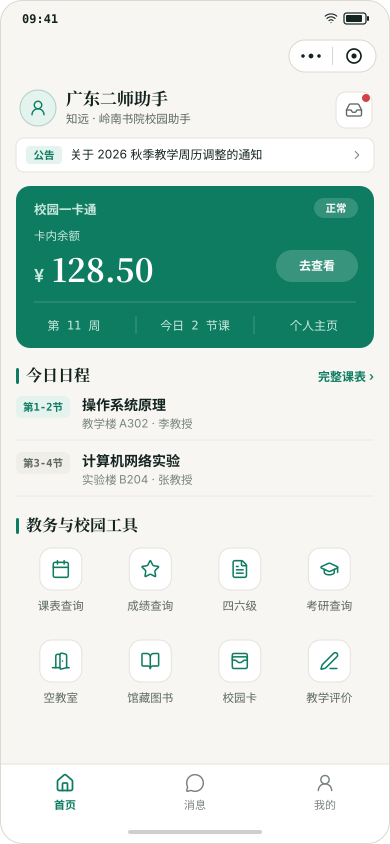
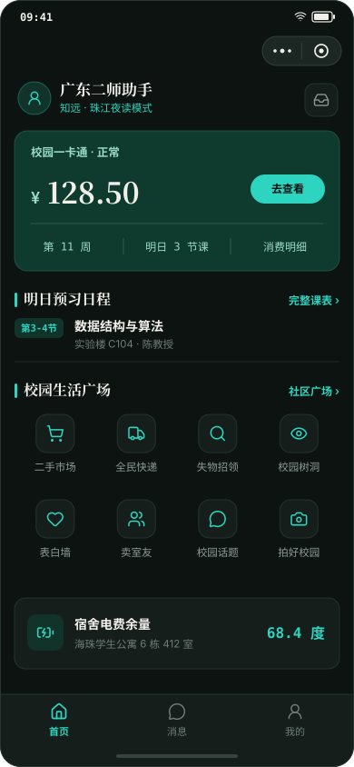
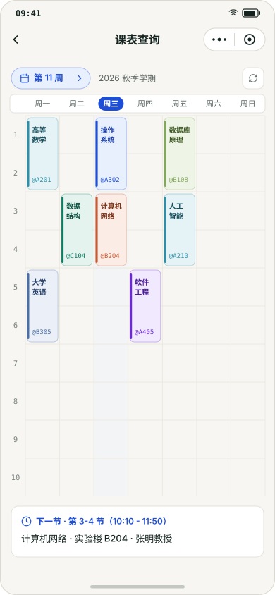
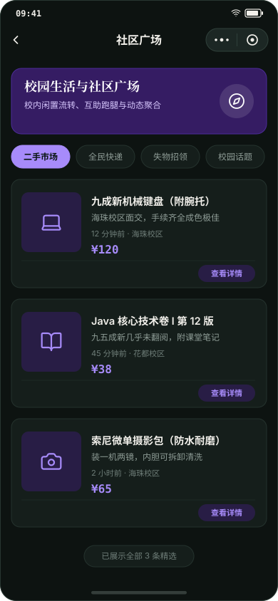
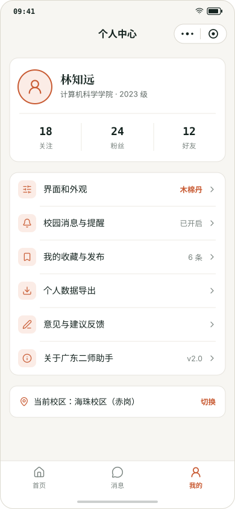
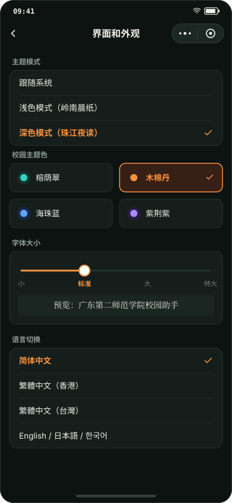

# 广东二师助手 · 微信小程序

广东第二师范学院校园助手的微信小程序客户端，基于原生小程序框架与 WeUI 样式库开发，覆盖教务查询、校园卡、社区生活、资讯与个人中心。

这个仓库只有小程序前端。数据来自 [GdeiAssistant 后端](https://github.com/GdeiAssistant/GdeiAssistant)，本仓库不包含服务端代码。项目由学生维护，不是学校官方服务。

## 功能模块

| 模块 | 内容 |
| --- | --- |
| 教务查询 | 课表、成绩、四六级、考研、空教室、馆藏图书、教学评价 |
| 校园生活 | 校园卡查询与挂失、宿舍电费、二手交易、失物招领、表白墙、校园树洞、全民快递、卖室友、话题、拍好校园 |
| 社区广场 | 聚合社区广场（`communityCenter` / `communityList` / `communityDetail` / `communityPublish`） |
| 个人中心 | 外观主题（明暗模式 / 4 套校园主题色 / 字号 / 6 种语言）、账号与隐私设置、意见反馈 |

## 技术栈

- 微信小程序原生框架 + 定制化 WeUI 样式系统
- Promise 风格服务层（`services/`）
- `mock` / `remote` 双数据源切换（Mock 模式可免后端运行全部主流程）
- 6 种语言国际化（`zh-CN`、`zh-HK`、`zh-TW`、`en`、`ja`、`ko`）与自定义底栏（`custom-tab-bar/`）

## 主题与设计系统

采用《岭南书院人文风》（Warm Editorial Lingnan Academy）设计规范，与 Web / Android / iOS 四端保持一致：

- **双模式画布**：通过 `theme.json` 与 `styles/theme.wxss` 支持浅色「岭南晨纸」（`#F7F6F2`）、深色「珠江夜读」（`#0D1311`）及跟随系统。
- **4 套校园主题色**：支持 **榕荫翠**（`banyan`）、**木棉丹**（`kapok`）、**海珠蓝**（`haizhu`）、**紫荆紫**（`bauhinia`），由 `utils/theme.js` 管理并与自定义 TabBar 实时同步。
- **多语言同步**：界面词条存放于 `locales/*.json`，通过脚本编译至 `locales/messages.generated.js`；修改文案后需重新生成并校验。
- 多端设计令牌规范见 [主仓说明](https://github.com/GdeiAssistant/GdeiAssistant#设计系统)，小程序端效果见下方 [界面预览](#界面预览)。

## 界面预览

以下为微信小程序端基于《岭南书院人文风》（Lingnan Editorial）设计系统的 6 张统一尺寸移动端矢量界面预览，展示首页、课表、社区广场、个人主页与外观设置，涵盖浅色「岭南晨纸」、深色「珠江夜读」及四套校园主题色：

<p align="center">
  
  
  
</p>

<p align="center">
  
  
  
</p>

## 工程目录

```text
├── app.js / app.json / app.wxss   全局入口、路由与基础样式
├── styles/theme.wxss              明暗主题与 4 套校园主题色 CSS 变量
├── custom-tab-bar/                自定义底部导航栏
├── pages/                         19 个主包页面
├── subpackages/                   15 个校园与社交分包页面
├── services/                      业务数据请求与 Mock 适配层
├── utils/                         主题切换、页面基类、格式化等工具
├── locales/                       6 种语言字典及生成产物
├── tests/                         Node 原生测试（含主题、i18n 与 Mock UI）
└── scripts/                       词条生成、结构冒烟与仓库卫生检查脚本
```

## 快速开始

### 环境要求

- 微信开发者工具
- 小程序基础库 `>= 2.32.3`
- Node.js `24.14.1`（与 `.nvmrc` 和 CI 一致）

### 本地运行

1. 使用微信开发者工具导入项目根目录。
2. 检查 `config/index.js` 中的接口环境与 `mock` 开关配置。
3. 编译并预览。

### 本地检查

```bash
npm ci
npm run locales:check
npm run lint
npm run format:check
npm test
npm run smoke
```

`npm test` 会先校验 `locales/` 与生成的 `locales/messages.generated.js` 是否一致；更新 `locales/*.json` 后请运行 `npm run locales:generate`。

## 部署说明

微信小程序发布与上传配置详见 [`docs/deployment.md`](docs/deployment.md)，社交与私信共享契约见 [GdeiAssistant 社交架构契约](https://github.com/GdeiAssistant/GdeiAssistant/blob/master/docs/social-messaging.md)。

## 相关仓库

- 后端与 Web 主仓：<https://github.com/GdeiAssistant/GdeiAssistant>
- Android 客户端：<https://github.com/GdeiAssistant/GdeiAssistant-Android>
- iOS 客户端：<https://github.com/GdeiAssistant/GdeiAssistant-iOS>

## 参与贡献

见 [CONTRIBUTING.md](CONTRIBUTING.md) 与组织行为准则 [CODE_OF_CONDUCT.md](https://github.com/GdeiAssistant/.github/blob/main/CODE_OF_CONDUCT.md)。安全问题请按 [SECURITY.md](SECURITY.md) 处理，不要在公开 Issue 里贴真实账号、验证码或密钥。

## 免责声明

本项目不代表学校官方服务。面向用户的协议、隐私政策和功能风险提示，以小程序内「关于」「隐私」「校园凭证」「二手」「跑腿」「失物招领」等页面展示的内容为准，本 README 不替代这些正文。

生产部署前，请自行确认校园凭证处理、第三方服务启用情况、日志脱敏、密钥管理、传输加密和商标使用边界。校园凭证相关的授权、撤回、删除和快速认证依赖后端支持，部署衍生版本前先确认后端的加密、授权持久化和删除行为已正确配置。

## 许可证

[Apache License 2.0](LICENSE) · [NOTICE](NOTICE) · [TRADEMARK.md](TRADEMARK.md)。
